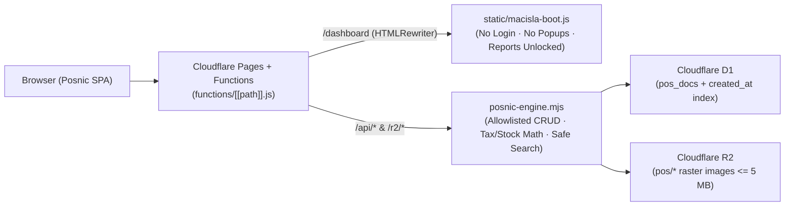

# Macisla POS

Posnic POS web application rebuilt on **Cloudflare Pages Functions + Cloudflare D1 + Cloudflare R2** — replacing MongoDB with serverless Cloudflare storage, zero login wall, zero marketing popups, persistent editable items, and all Reports unlocked.

## Webapp Overview

- **Direct-to-POS Boot:** Opening `/` or `/dashboard` routes straight into `#/sales/new` as `Macisla Admin` (no login screen, no passcode wall, no marketing/license popups).
- **Editable Catalog & Persistence:** Items, categories, customers, suppliers, sales, receivings, expenses, and settings persist in Cloudflare D1 (`pos_docs`), with item photos stored in Cloudflare R2 under `pos/*`.
- **Unlocked Reports:** Full Posnic reporting suite (Daily Sales, Summary, Item/Category, Customer, Payment, Tax, Expenses, Receivings) runs against D1 with `Asia/Jakarta` timezone and `IDR (Rp)` defaults.
- **One-Time Starter Seed:** An empty database seeds once with the starter branch, Walk-in Customer, payment modes, tax presets, and 3 Macisla services (0 fake sales) so subsequent edits are never overwritten on deploy.
- **Local Dev Parity:** The same API engine (`posnic-engine.mjs`) runs locally against SQLite (`storage.js`) and local disk uploads (`data/uploads/`).

## Architecture



### Key Files

- `functions/[[path]].js` — Cloudflare Pages catch-all Function: injects `/static/macisla-boot.js` on `/dashboard` via `HTMLRewriter`, redirects `/login*` to `/dashboard#/sales/new`, routes `/r2/*` and `/api/*` directly to the Worker before static extension passthrough, and bridges D1/R2 to the API engine.
- `posnic-engine.mjs` — Posnic REST API implementation (catalog, sales, stock deltas, tax/discount math, reports, settings, R2 media handler).
- `static/macisla-boot.js` — Client bootstrap script setting session state, locking `userplan=premium`, and suppressing marketing/demo nudges.
- `schema.sql` & `seed-data.mjs` — D1/SQLite `pos_docs` schema (`idx_pos_docs_collection`, `idx_pos_docs_collection_created`) and initial Macisla seed data.
- `server.js` & `storage.js` — Local Node HTTP + SQLite runner for development and testing.

## Security & Hardening Completed (Audit `#1`–`#8`)

| Area | What Is Enforced |
| :--- | :--- |
| **#1 R2 Isolation & Uploads** | `/r2/*` restricted strictly to `pos/` (blocks traversal & cross-app reads with HTTP `403`); raster-only uploads (`png`, `jpg`, `jpeg`, `gif`, `webp`, `bmp`, `<= 5 MB`, max 12/call); served with `X-Content-Type-Options: nosniff` and `Content-Security-Policy: default-src 'none'; sandbox`; Worker-first routing for `/r2/*` and `/api/*`. |
| **#2 API & D1 Write Hygiene** | Removed wildcard `access-control-allow-origin: *` on API JSON responses; `POST /client-errors` returns `200` without writing to D1; Generic CRUD restricted to an explicit POS collection allowlist (`CRUD_COLLECTIONS`). |
| **#3 Sale Edit Integrity** | Editing an existing sale preserves original `created_date`/`date` and applies stock deltas rather than deducting tracked inventory twice. |
| **#4 Discount & Tax Accuracy** | `Rp 0` (100% discounted) sales are preserved explicitly instead of falling back to catalog totals; shared `calcPriceBreakdown` aligns inclusive/exclusive tax across checkout and `dailySalesReports`. |
| **#5 Default Entity Payloads** | `setting/getDefaultCustomer` and `setting/getDefaultSupplier` return Posnic's expected `customer_*` / `supplier_*` fields for receipts and `localStorage`. |
| **#6 Credential Hygiene** | No plaintext passwords in `seed-data.mjs`, D1 `users` rows, or `GET /users` API responses (`password`, `retype_password`, `app_key` stripped on read/write). |
| **#7 Safe Search Filtering** | Replaced runtime `new RegExp(...)` compilation in `applyListFilters` with safe lowercase token matching (`extractSearchTokens`). |
| **#8 Bounded SQL Queries** | Added `idx_pos_docs_collection_created` and `listRange(collection, { sinceIso, untilIso, limit })` so dashboard, recent sales, and date-filtered reports avoid full-table scans. |

## Access Control (Optional Cloudflare Zero Trust)

By design, Posnic's built-in login screen is disabled for instant counter access. To restrict the deployed Pages domain to staff only without adding an app password screen:

1. Open **Cloudflare Zero Trust -> Access -> Applications -> Add an application -> Self-hosted**.
2. Point it at your Cloudflare Pages hostname and attach an **Allow** policy for approved staff emails (Cloudflare Zero Trust Free includes up to 50 users at $0/month).

## Local Development & Testing

```bash
npm start   # http://127.0.0.1:3088 (SQLite in data/macisla_pos.db)
npm test    # node --test test/pos.test.js
```

## Cloudflare Pages Deployment

Bindings are declared in `wrangler.toml` and attached in the `macisla-pos` Cloudflare Pages project:

- **D1 binding:** `DB`
- **R2 binding:** `R2_BUCKET`
- **Build command:** *(empty)* · **Output directory:** `.`

## Known Limitations & Roadmap (Audit `#9`–`#15`)

- `#9` Make receipt sequence increments and tracked stock adjustments atomic in SQL for simultaneous multi-tablet checkouts.
- `#10` Return HTTP `400` loudly if an R2 upload is empty or unconfigured.
- `#11` Align Cloudflare Pages `preview` environment D1/R2 bindings (or disable preview deployments).
- `#12` Clear remaining minor Posnic `dashboard.8de0f236.js` console `TypeError`s on boot.
- `#13` Automate `npm test` via GitHub Actions on push/PR.
- `#14`–`#15` Remove unused static assets, dead middleware, and minor duplicate reads.
